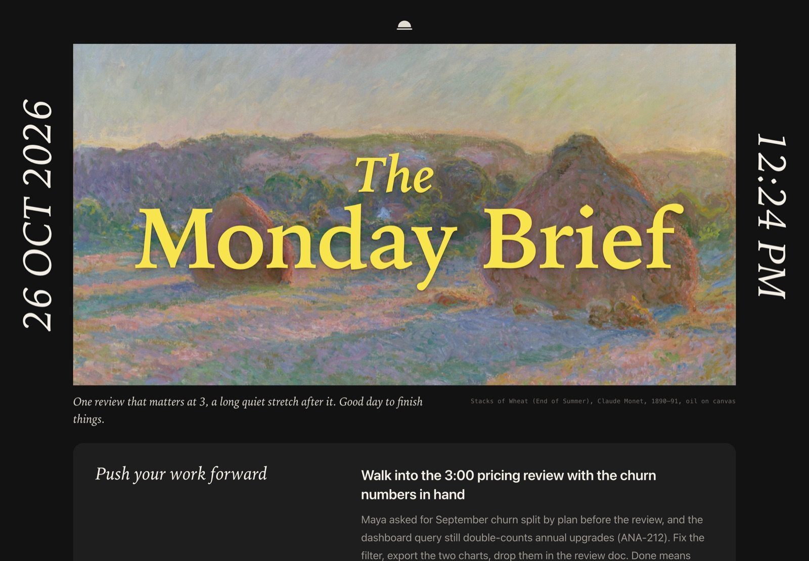
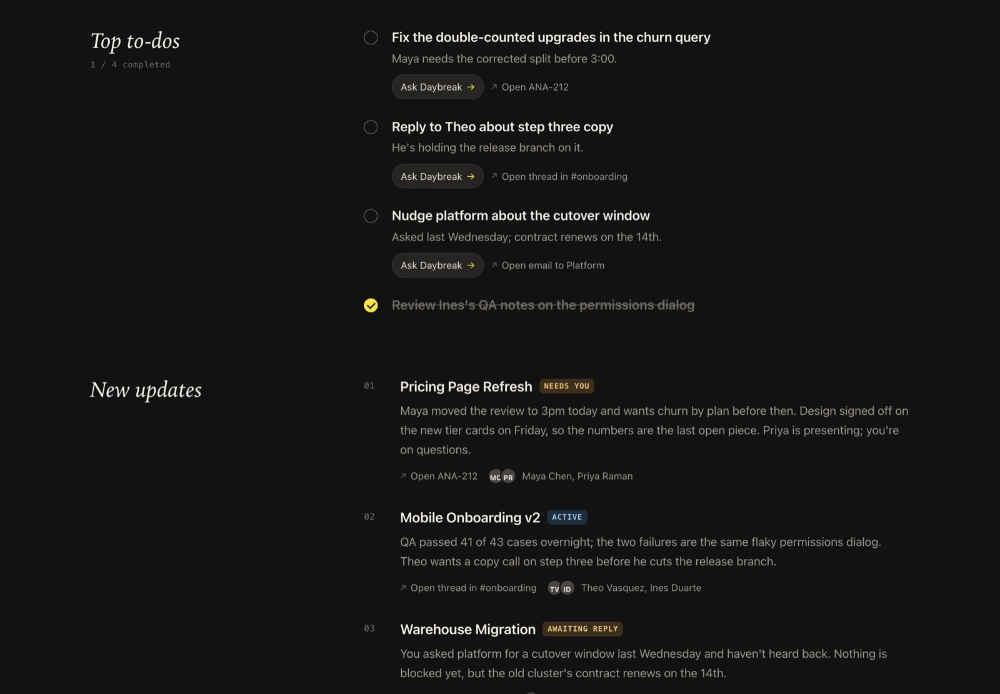
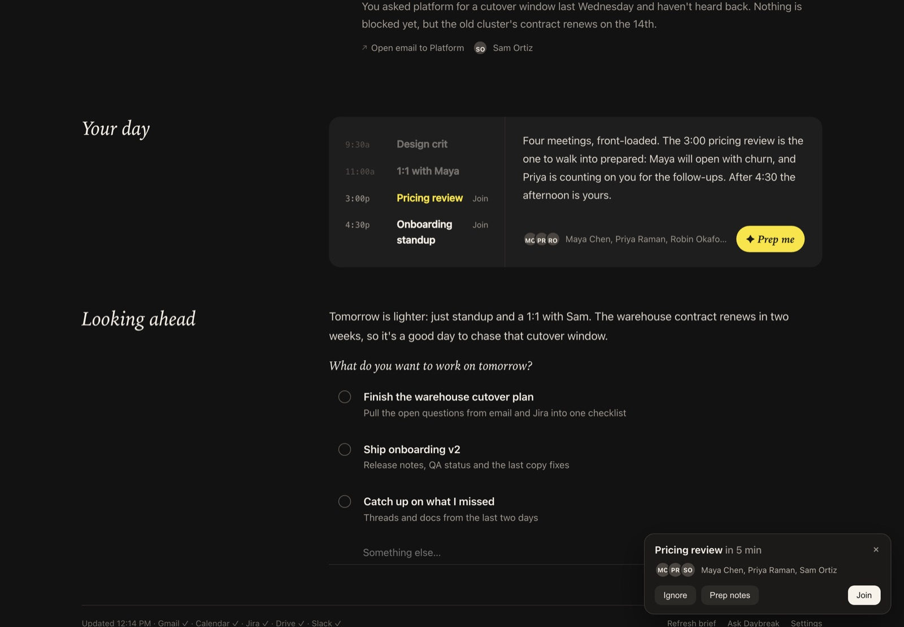
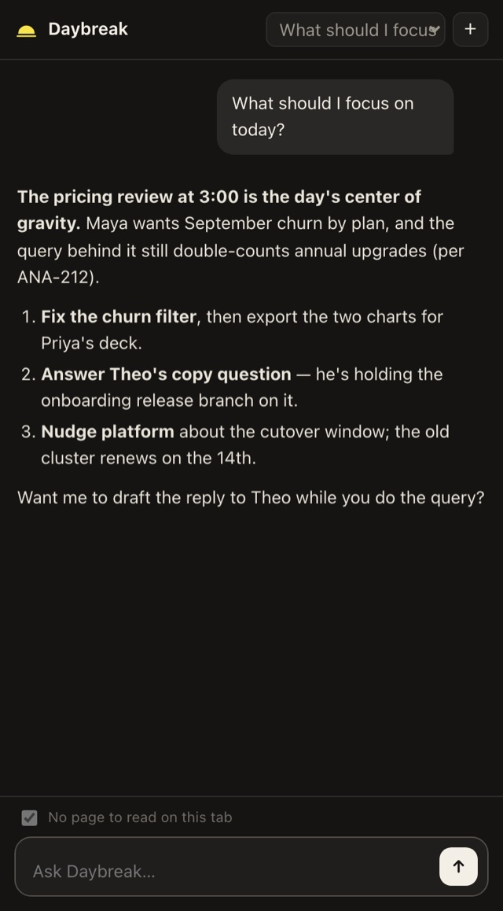

<p align="center">
  
</p>

<h1 align="center">Daybreak</h1>

<p align="center"><em>A quiet morning brief for your browser.</em></p>

<p align="center">
  Runs on your own Claude subscription · Lives on your computer · Works in any Chromium browser · MIT
</p>

---

Most workdays begin with a pile of unread things and a faint sense that something important is hiding in it.
Daybreak begins them with a painting.

Every weekday, a little before your day starts, it reads what happened while you were away: email, calendar,
tickets, docs and Slack. Then it writes you one calm page and leaves it on your new tab. It tells you what matters
today, who is waiting on you, which meeting deserves ten minutes of preparation, and what can safely wait until
Thursday.

Think of it as the colleague who gets in early, reads everything, and leaves a tidy note on your desk. This one never
asks for credit.

## What's on the page



The brief opens with **Push your work forward**: the one or two moves that would make today count. It arrives with
the ticket numbers, names and deadlines already filled in, so you don't have to go digging. Next to it sits a yellow
starburst that says *Let's do it*. Press it and Daybreak starts on the work with you. We tried removing the sticker
once. It felt wrong.

**Top to-dos** are the loops you owe other people. Each one has a link back to where it came from, and a button that
hands the job to the assistant.

**New updates** tells you what moved in each thing you're working on since yesterday. Every item is numbered, carries a
status tag (*Active*, *Awaiting reply*, *Needs you*), and shows who's involved.

**Your day** lays out your meetings and points at the one worth preparing for.

**Looking ahead** asks what you'd like to work on tomorrow. Tomorrow's brief remembers your answer.

The brief opens as its own tab the first time you use your browser in the morning. You can bring it back any time
with ⌥⇧B.

## The rest of the day



Five minutes before a meeting, a small card slides into the corner of whatever page you're on, with **Ignore**,
**Prep notes** and **Join**. The prep notes are written ahead of time from your email, tickets and docs. They cover
what the meeting is really about, what's likely to come up, and what you might want to ask.

When someone is genuinely waiting on you, Daybreak may tap you on the shoulder. Gently. At most three times an hour,
and never in the evening.



Open the side panel (⌥⇧D) and you have an assistant that already knows your week. You can:

- ask about the page you're reading, or about the project behind it
- have it draft the reply you've been putting off (it writes the draft and never sends it)
- turn a messy thread into a one-pager, a deck or a recap
- set up recurring jobs like *"every weekday at 5:30, recap what I shipped"*

<br clear="right">

## What Daybreak will never do

- **Send, post or change anything.** Background work is read-only. Chat can write email drafts, and that's where it
  stops.
- **Ping you after hours.** Pop-ups respect your work hours and a rate limit.
- **Ask for an API key.** It uses the Claude subscription you already have, through the Claude Agent SDK.
- **Phone home.** Everything lives in one folder on your computer. The only outside calls go to your Claude account,
  the tools you've connected, and a museum (for the painting).

## Getting started

You'll need [Claude Code](https://docs.claude.com/en/docs/claude-code) signed in with a Claude subscription (`claude`,
then `/login`), and Python 3.11 or newer. For a good brief, connect Gmail, Google Calendar, Google Drive and Atlassian
under claude.ai → Settings → Connectors. Daybreak uses whatever is connected and skips the rest.

**1. Install the helper**

```bash
git clone https://github.com/kiraa06/daybreak.git && cd daybreak
python3 -m venv .venv && .venv/bin/pip install -e .
.venv/bin/daybreak install
```

`install` does four things:

- copies Daybreak into its own environment in your data folder
- copies the extension there too
- registers it with every Chromium browser it finds (Chrome, Edge, Brave, Arc, Dia, Vivaldi, Opera, Chromium)
- starts the helper at login: a launchd agent on macOS, a systemd user service on Linux

**2. Load the extension.** Open `chrome://extensions` (or `edge://`, `brave://`), turn on *Developer mode*, choose
*Load unpacked*, and pick the folder `install` printed. Keep the new-tab page when the browser asks.

**3. That's it.** If it's a weekday, your first brief shows up within a few minutes; otherwise it arrives on the next
weekday morning. You can also run `.venv/bin/daybreak brief` and open a new tab.

If the extension says it can't find the helper, run `daybreak pair` and paste the output into the extension's
settings page.

## How it works

```
Gmail · Calendar · Drive · Jira/Confluence   ← your claude.ai connectors, read-only
Slack                                        ← the Slack session already signed in to your browser
Bitbucket (optional)                         ← an API token
        │
        ▼
 sensors ─► small typed events (request · commitment · decision · blocker · context)
        ─► router ─► workstreams ─► synthesis (overview, timeline, open loops) ─► curator (what matters today)
        ─► the brief · meeting prep · pop-ups · chat context
```

The **helper** is a small Python service.

- Every half hour during work hours, it asks Claude to read each source within a strict budget of tool calls.
- Each finding is labelled as a request, a commitment, a decision, a blocker or a bit of context.
- Findings are grouped into **workstreams**: the actual efforts you're juggling, like a migration, a launch or an
  incident.
- Each workstream keeps a short, honest summary that never claims more than the sources say.
- Connector tools run behind a permission gate that allows reading and nothing else.

The **extension** is plain Manifest V3 with no build step. It draws the new-tab brief, the side panel and the pop-ups.
It finds the helper through a native-messaging host, then talks to it on `127.0.0.1` with a token. In browsers without
a side panel (Arc, Opera), chat opens in a small window instead.

## Slack, without installing an app

Plenty of workspaces don't let you install Slack apps, so by default Daybreak reads Slack through the session you're
already signed in with:

1. It looks up the Slack web client's workspace token in `app.slack.com`'s local storage (`localConfig_v2`). If that
   isn't there yet, it opens Slack once in a background tab and lets Slack write it.
2. It makes the same read-only calls the Slack web client makes: `activity.feed`, `client.counts`,
   `search.modules.messages` and `conversations.history`/`replies`, plus Slack's edge cache for names.

The token stays in your browser, and only the conversations it reads reach the helper on your computer. Two honest
caveats:

- These are Slack's internal web APIs, so Slack can change them.
- They act with your own Slack permissions, so follow your workspace's rules.

If your workspace allows it, you can switch to the claude.ai Slack connector in the extension's settings.

## Commands

| Command | What it does |
|---|---|
| `daybreak run` | run the helper in the foreground |
| `daybreak brief` | write today's brief now |
| `daybreak sense [--hours N]` | read your sources and update workstreams now |
| `daybreak calendar` | refresh meetings |
| `daybreak prep [meeting-id\|next]` | write prep notes for a meeting |
| `daybreak status` | show what the helper is up to |
| `daybreak pair` | print pairing details for the extension's settings page |
| `daybreak install` / `uninstall` | set up or remove the login service and browser registration |

Settings live in `config.toml` in the data folder. You can change the brief time, work hours, pop-up timing, sources
and models there. The data folder is:

- macOS: `~/Library/Application Support/Daybreak`
- Linux: `~/.local/share/daybreak`
- Windows: `%LOCALAPPDATA%\Daybreak`

## Questions people ask

**Why a painting?**
Because the first thing you see in the morning should be nicer than an inbox. Each day brings a different painting
from the Art Institute of Chicago's public-domain collection, credited in the corner. Sometimes it's Monet. Sometimes
it's a cow. Both are good.

**Does it cost anything?**
Daybreak is free. It does use some of your Claude subscription's usage, mostly for the half-hourly background reads. If
you'd like it to go easier, raise `sense_every_minutes` in the config.

**Which browsers?**
Any Chromium browser that loads unpacked extensions. It's tested in Chromium and set up for Chrome, Edge, Brave, Arc,
Dia, Vivaldi and Opera.

**Windows?**
Mostly. The browser registration works, but you start `daybreak run` yourself, or with Task Scheduler. macOS and Linux
get a proper login service.

**What if Claude gets something wrong?**
The prompts are strict about only saying what the sources say, and every item links back to where it came from. When
it's unsure, it says less. Still, it's a summary, so check before you act on anything important.

**Why "Daybreak"?**
It's the quiet part of the day before the day starts. That's where this lives.

## Privacy

Your data stays on your computer, in the data folder above. Model calls go through your own Claude account.
Background runs are read-only, and nothing is ever sent on your behalf. You can delete the folder to make Daybreak
forget everything.

## Contributing

Issues and pull requests are welcome, especially from people with workflows unlike ours.

- `daybreak install --editable` runs the login service straight from your checkout.
- `DAYBREAK_DEV=1 daybreak run` serves the extension pages at `http://127.0.0.1:47821/dev/newtab.html` with a stub
  `chrome` API, so you can work on the UI without reloading anything.
- `python tests/e2e_extension.py` loads the real extension into a throwaway Chromium profile and checks pairing, the
  brief, a pop-up and the side panel.
- `python docs/make_demo.py` regenerates the screenshots above from made-up data. Please keep real accounts out of
  screenshots and issues.

If you ship your own build of the extension under a different ID, add the ID to `extra_extension_ids` in
`config.toml` and run `daybreak install` again.

## Credits

Inspired by the Morning Brief in Dia's Better Days plan, and built for people who wanted that feeling in the browser
they already use. Paintings courtesy of the Art Institute of Chicago's open-access (CC0) collection. Not affiliated
with The Browser Company, Anthropic or Slack.

## License

MIT. Be kind with it.
